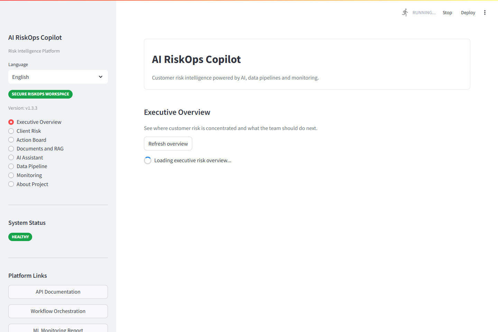
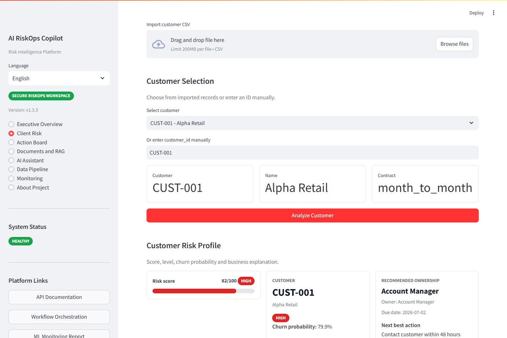
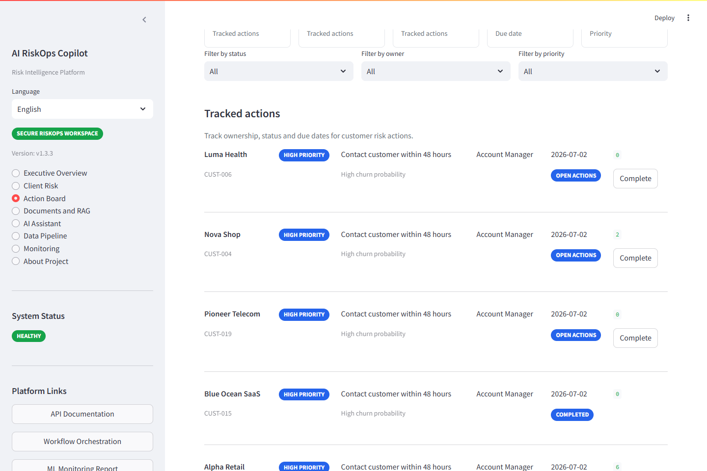
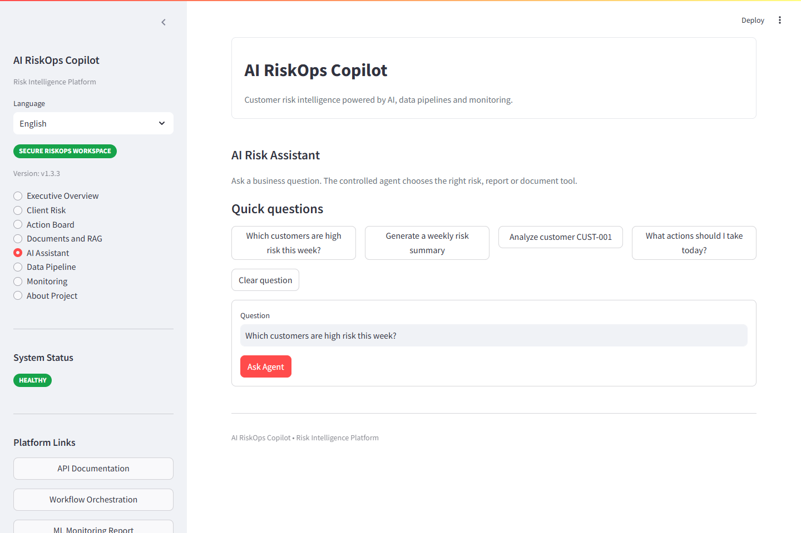
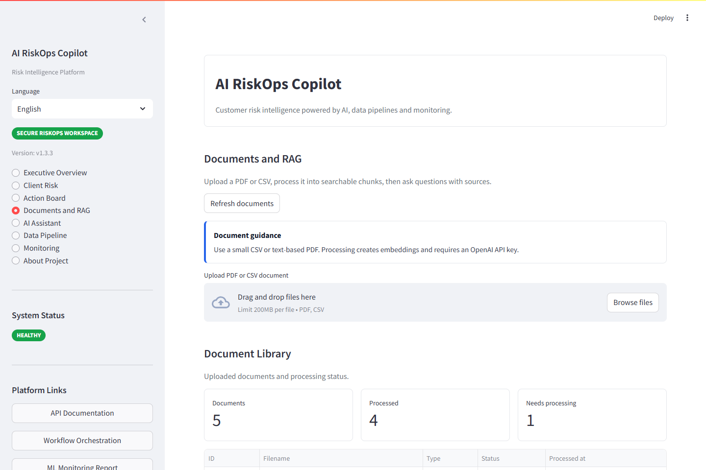
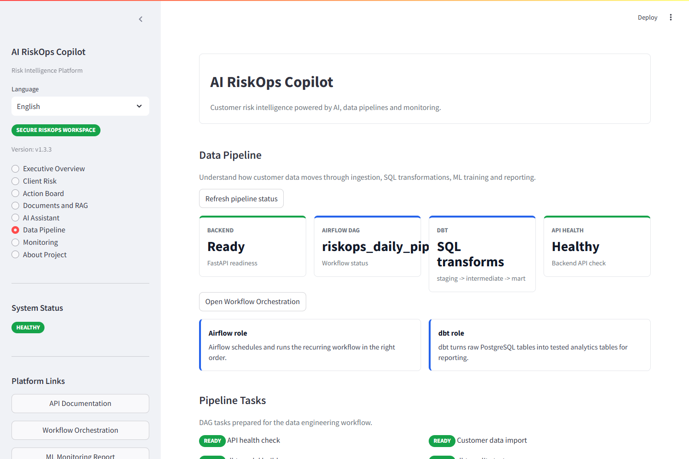
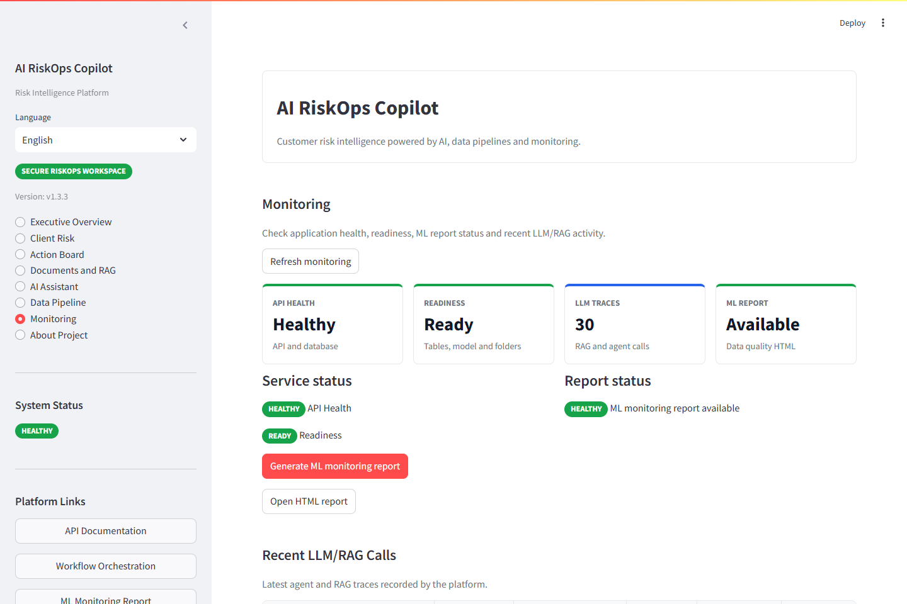
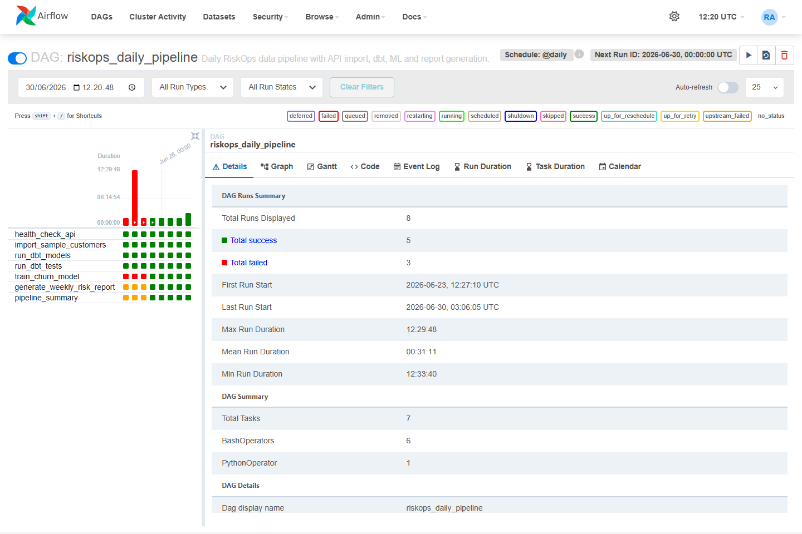
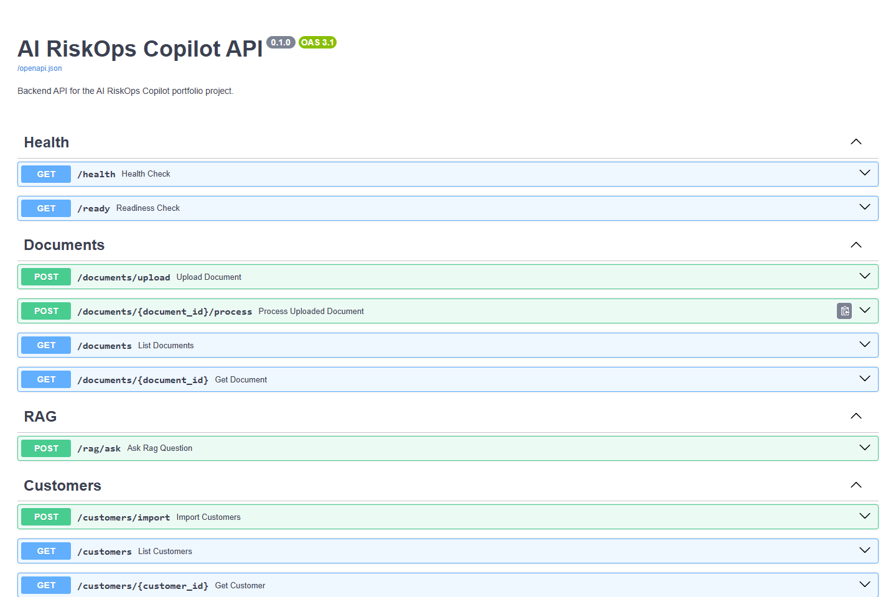

# AI RiskOps Copilot

AI RiskOps Copilot is a full-stack AI portfolio project for customer risk operations.
It combines document intelligence, structured customer data, churn prediction, controlled AI agents, data pipelines and monitoring.
The goal is to show how an AI product can move from a demo chatbot to a production-minded decision support system.

## Business Problem

Risk signals are often scattered across contracts, CSV exports, invoices, support tickets and internal reports. A manager needs to know which customers are at risk, why they are risky, and what action to take first.

AI RiskOps Copilot answers questions like:

- Which customers are most likely to churn this week?
- Why is a customer risky?
- What actions should the team prioritize?
- What do uploaded documents say about a risk?
- Is the system healthy and ready for a demo or local deployment?

## Solution

The project provides a local AI application with:

- a Streamlit dashboard for users,
- a FastAPI backend for product APIs,
- PostgreSQL and pgvector for business data and vector search,
- PDF/CSV upload and document processing,
- RAG over processed document chunks,
- document risk extraction linked to customer ids,
- Client 360 summaries and action plans,
- persisted action workflow with owner, status and due date tracking,
- XGBoost churn prediction with MLflow tracking,
- a controlled LangGraph agent for routing questions,
- Airflow and dbt pipelines,
- MLOps and LLMOps monitoring,
- Docker and GitHub Actions for reproducibility.

## Architecture


Mermaid version: [docs/architecture-final.md](docs/architecture-final.md)

```text
Streamlit
  -> FastAPI
  -> PostgreSQL + pgvector
  -> RAG + OpenAI API
  -> XGBoost + MLflow
  -> LangGraph agent
  -> Airflow + dbt
  -> Monitoring reports + JSONL traces
```

## Technical Stack

- Backend: FastAPI, SQLAlchemy, Pydantic
- Frontend: Streamlit
- Database: PostgreSQL, pgvector
- RAG: OpenAI embeddings, LlamaIndex-ready services, vector search
- ML: XGBoost, scikit-learn, pandas, joblib
- MLOps: MLflow, local data quality report
- LLMOps: JSONL traces, optional Langfuse export
- Data engineering: Airflow, dbt
- DevOps: Docker Compose, GitHub Actions

## Features

- Upload PDF and CSV files.
- Store document metadata in PostgreSQL.
- Extract PDF text and CSV content.
- Chunk document text.
- Create embeddings and store vectors with pgvector.
- Ask RAG questions with source chunks.
- Link processed documents to customers when a `customer_id` appears in the filename or extracted chunks.
- Extract document risk signals such as unpaid invoices, support escalations, penalties, termination and legal risk.
- Generate a Client 360 view and an operational action plan.
- Persist recommended actions into an Action Board.
- Track action status: open, in progress, completed and cancelled.
- Import sample customer data from CSV.
- Train a churn model.
- Analyze customer risk.
- List priority customers.
- Generate a weekly risk report.
- Route controlled business questions with LangGraph.
- Generate an ML monitoring HTML report.
- Trace RAG and agent calls locally.
- Check health and readiness.

## Main Endpoints

- `GET /health`
- `GET /ready`
- `POST /documents/upload`
- `POST /documents/{document_id}/process`
- `GET /documents`
- `GET /documents/{document_id}`
- `POST /rag/ask`
- `POST /customers/import`
- `GET /customers`
- `POST /risk/analyze-customer`
- `GET /risk/explain/{customer_id}`
- `GET /risk/document-risk/{customer_id}`
- `GET /risk/client-360/{customer_id}`
- `GET /risk/action-plan`
- `GET /actions/plan`
- `POST /actions/sync`
- `GET /actions`
- `PATCH /actions/{action_id}`
- `POST /actions/{action_id}/complete`
- `GET /actions/board`
- `GET /risk/priority-customers`
- `GET /risk/history`
- `GET /reports/weekly-risk`
- `POST /agent/analyze`
- `POST /monitoring/ml/generate-report`
- `GET /monitoring/ml/report`
- `GET /monitoring/ml/report?format=html`
- `GET /monitoring/llm/traces`
- `GET /monitoring/llm/summary`

## How To Run

Recommended on Windows PowerShell:

```powershell
scripts/dev/start.ps1
```

Alternative if PowerShell execution policy blocks local scripts:

```powershell
powershell -ExecutionPolicy Bypass -File scripts/dev/start.ps1
```

Cross-platform Docker command:

```bash
docker compose up -d --build
```

Bash helper scripts are also available under `scripts/dev/*.sh`. On Windows, prefer the PowerShell scripts unless Docker Desktop is integrated with your WSL shell.

Useful URLs:

- FastAPI docs: http://localhost:8000/docs
- Streamlit: http://localhost:8501
- Airflow: http://localhost:8080
- Health: http://localhost:8000/health
- Ready: http://localhost:8000/ready
- MLflow: local `./mlruns` directory

Docker build note:

- Cached rebuild measured locally during the portfolio release: about 14 seconds.
- A first uncached build can take several minutes because backend ML/RAG packages and Airflow/dbt packages are installed.
- `.env` is optional for Docker Compose; secrets are not required for local CI validation.

## Deployment Readiness

The project includes GitHub Actions for Python validation, repository hygiene checks and Docker image builds. The Docker workflow builds backend and frontend images on pull requests and pushes, and can publish tagged releases to GitHub Container Registry on tags matching `v*`.

See [docs/deployment.md](docs/deployment.md) for local Docker Compose deployment, environment variables, health checks, a simple VPS path and production limits.

## n8n Automation Layer

The portfolio includes an n8n workflow named `AI RiskOps GitHub Maintainer` for weekly RiskOps automation. It checks the RiskOps API, generates an AI report, runs a RiskOps Quality Gate, creates an OpenAI visual snapshot, opens a labeled GitHub issue and writes a Markdown report in `docs/reports`.

The hardened automation also documents an `AI RiskOps Error Handler` workflow for incident issue creation and includes a weekly duplicate issue guard to avoid duplicate reports and unnecessary OpenAI image cost. The workflow uses anonymized customer aliases only, so raw customer identifiers are not exposed in generated reports, images or issue bodies. See [docs/n8n/README.md](docs/n8n/README.md) for import, credential and security instructions.

## Final Product UI

The Streamlit interface is finalized for `v1.3.3-action-workflow`, a recruiter-ready product shell with eight pages:

- Executive Overview
- Client Risk
- Action Board
- Documents and RAG
- AI Assistant
- Data Pipeline
- Monitoring
- About Project

Reusable UI components live in `frontend/components.py`, and API calls are centralized in `frontend/api_client.py`. The interface uses KPI cards, risk badges, status badges, empty states and technical detail expanders so business users are not exposed to raw JSON by default.

Risk colors:

- High risk: red `#DC2626`
- Medium risk: orange `#F59E0B`
- Low risk and healthy: green `#16A34A`
- Primary actions: blue `#2563EB`

## Recommended Demo Flow

This version demonstrates an end-to-end AI RiskOps workflow from data ingestion and document intelligence to explainable risk scoring and tracked business actions.

1. Executive Overview
2. Client Risk
3. Action Board
4. Documents and RAG
5. AI Assistant
6. Data Pipeline
7. Monitoring
8. About Project

The first three pages show the business value first: risk prioritization, one-customer analysis, document-backed evidence and tracked ownership. The remaining pages show document intelligence, controlled agent routing, data engineering, observability and project positioning.

## Product Screenshots

### Executive Overview



### Client Risk



### Action Board



### AI Assistant



### Documents and RAG



### Data Pipeline



### Monitoring



### Airflow DAG



### FastAPI Docs



Action workflow demo:

1. Open Executive Overview and review the automatic action plan.
2. Open Action Board.
3. Click `Sync Recommended Actions`.
4. Filter by owner, status or priority.
5. Complete one action and verify the status changes to completed.

Document risk demo:

Upload and process a small CSV or PDF containing a sentence such as:

`A high-risk customer has two unpaid invoices, repeated support escalations and a contract penalty for late payment.`

After processing, the document risk endpoint links the document to the selected customer, extracts signals, returns evidence previews and feeds the document component of Risk Score v2.

Deployment readiness:

- The app runs locally with Docker Compose.
- Health and readiness endpoints are available.
- Secrets remain outside Git through `.env`.
- Generated data, traces, reports and MLflow runs are ignored.
- Next deployment step is cloud packaging with authentication and managed infrastructure.

See [docs/ui-guide.md](docs/ui-guide.md) for the UI structure, colors, components and recommended demo flow.

## Demo Mode

Prepare a complete local demo:

```powershell
scripts/dev/demo-seed.ps1
```

Alternative:

```powershell
python scripts/dev/demo_seed.py
```

The demo seed script:

- waits for the backend,
- imports `data/sample/customers_sample.csv`,
- verifies or trains the churn model,
- analyzes a sample customer,
- lists priority customers,
- generates the weekly risk report,
- generates the ML monitoring report,
- creates an agent trace,
- prints a final summary and useful URLs.

## Demo-Safe Security Controls

This release includes lightweight safeguards for local portfolio demos:

- CORS is configurable with `BACKEND_CORS_ORIGINS` and defaults to the local Streamlit URLs.
- Upload size is limited with `MAX_UPLOAD_SIZE_MB`, defaulting to 10 MB.
- Document upload accepts supported file types only: `.pdf` and `.csv`.
- Sensitive endpoints use simple in-memory rate limiting with `RATE_LIMIT_PER_MINUTE`, defaulting to 60 requests per minute per IP.
- Secrets stay outside Git through `.env`; only `.env.example` is committed.

This is still a portfolio/demo system. It is not enterprise-ready without authentication, authorization, audit logging, malware scanning, managed secrets and production infrastructure.

## Data Pipeline

Airflow orchestrates the local workflow. dbt builds analytics models from PostgreSQL data:

- `stg_customers`
- `int_customer_risk_features`
- `mart_customer_risk_summary`

The pipeline demonstrates ingestion, transformation, testing and reporting without requiring a cloud platform.

## ML Pipeline

The churn pipeline uses the sample customer dataset or PostgreSQL data when available. It trains an XGBoost classifier, logs metrics with MLflow, and writes model artifacts to `ml/models`.

Model outputs are used by:

- `POST /risk/analyze-customer`
- `GET /risk/priority-customers`
- `GET /reports/weekly-risk`
- `POST /agent/analyze`

## RAG Pipeline

The document pipeline uploads PDF/CSV files, extracts text, chunks content, creates embeddings and stores vectorized chunks with pgvector. `/rag/ask` retrieves relevant chunks and returns an answer with sources.

OpenAI is optional for non-RAG demo paths. If no API key is configured, customer risk, reporting, monitoring and agent priority routing still work.

## LangGraph Agent

The agent is intentionally controlled. It routes questions to known tools:

- customer analysis,
- priority customers,
- weekly report,
- RAG over documents,
- fallback guidance.

This makes the system easier to defend in an interview than an uncontrolled free-form agent.

## Monitoring

MLOps:

- `POST /monitoring/ml/generate-report` creates `monitoring/reports/ml_data_quality_report.html`.
- The report compares reference sample data with current PostgreSQL customers.
- It checks missing values and simple feature drift for tenure, charges, support tickets and late payments.
- Evidently is treated as an optional monitoring concept; the app keeps a dependency-safe local HTML fallback.

LLMOps:

- `POST /rag/ask` and `POST /agent/analyze` are traced.
- Local traces are written to `monitoring/logs/llm_traces.jsonl`.
- Traces capture timestamp, question, selected tool, latency, status, errors, source count and document id.
- Langfuse export is optional and protected by environment variables.

Health:

- `/health` reports API, database, model and pgvector status.
- `/ready` verifies database connectivity, required tables, model artifact and monitoring folders.

## Limits

- This is a local portfolio release, not a cloud deployment.
- Authentication and authorization are intentionally out of scope.
- The RAG path needs an OpenAI API key for embeddings and generated answers.
- The ML dataset is small and designed for demonstration.
- The monitoring report is lightweight and local.
- No real AWS infrastructure is created in this version.

## Roadmap

- Add authentication for multi-user access.
- Deploy to AWS with managed PostgreSQL and container hosting.
- Add real alerting for drift and failed traces.
- Add stronger evaluation for RAG answers.
- Add CI tests with a temporary PostgreSQL service.
- Add screenshots and a short demo video.

## What This Project Demonstrates

- Product thinking around a business risk use case.
- Backend API design with FastAPI.
- Relational and vector data modeling.
- RAG architecture with source traceability.
- Machine learning training and serving.
- MLOps and LLMOps basics.
- Data engineering orchestration with Airflow and dbt.
- Dockerized local development.
- Recruiter-ready documentation and demo flow.

## Interview Questions To Prepare

- Why is this more than a chatbot?
- How does pgvector support RAG?
- Why use a controlled LangGraph agent?
- What happens when OpenAI is unavailable?
- How do `/health` and `/ready` differ?
- What does the ML monitoring report detect?
- How would you deploy this on AWS?
- What would you improve before production?

See also:

- [docs/portfolio-case-study.md](docs/portfolio-case-study.md)
- [docs/interview-pitch.md](docs/interview-pitch.md)
- [docs/interview-qa.md](docs/interview-qa.md)
- [docs/demo-script.md](docs/demo-script.md)
