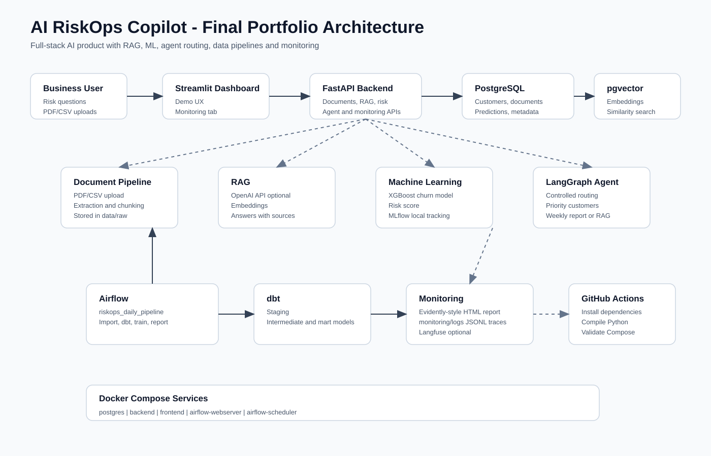

# AI RiskOps Copilot

AI RiskOps Copilot is a portfolio project that demonstrates AI Engineering, Data Engineering, Machine Learning, MLOps and LLMOps skills.

The goal is to build an AI assistant that helps a company detect business risks from documents, customer data and operational signals.

## Business Problem

Companies often store important risk signals across many sources:

- contracts
- invoices
- customer files
- support tickets
- sales CSV files
- internal reports

Managers need fast answers to questions like:

- Which customers may churn this week?
- Which invoices look risky?
- Which contracts contain risky clauses?
- Which support tickets are urgent?
- Which actions should the team take first?

This project solves that problem with a complete AI system, not a simple chatbot.

## MVP Scope

The first version focuses on:

- FastAPI backend
- Streamlit dashboard
- PostgreSQL database
- pgvector for future semantic search
- PDF and CSV upload foundation
- RAG-ready database schema
- churn risk dataset sample
- Docker setup

Future versions will add:

- RAG with LlamaIndex
- OpenAI embeddings
- XGBoost churn prediction
- MLflow tracking
- LangGraph agent
- Risk Score
- Airflow and dbt pipelines
- Langfuse and Evidently AI monitoring
- AWS deployment

## Architecture

Visual architecture:



```text
User
  -> Streamlit dashboard
  -> FastAPI backend
  -> PostgreSQL + pgvector
  -> LlamaIndex RAG
  -> XGBoost churn model
  -> LangGraph decision agent
  -> MLflow, Langfuse, Evidently AI
```

## Project Structure

```text
riskops-ai-copilot/
  backend/          FastAPI application
  frontend/         Streamlit dashboard
  ml/               ML training and model artifacts
  data/             raw, processed and sample data
  pipelines/        Airflow and dbt future modules
  docs/             project documentation
  scripts/          database initialization scripts
```

## Quick Start

1. Copy the environment file.

```bash
cp .env.example .env
```

2. Start the project.

```bash
docker compose up --build
```

3. Open the services.

- Backend API: `http://localhost:8000`
- API health: `http://localhost:8000/health`
- API docs: `http://localhost:8000/docs`
- Streamlit dashboard: `http://localhost:8501`

## Backend Endpoints

- `GET /health`: API health check.
- `POST /documents/upload`: upload one PDF or CSV file and store metadata in PostgreSQL.
- `GET /documents`: list uploaded documents.
- `GET /documents/{document_id}`: get one document by id.

Uploaded files are stored in `data/raw`.

## Local Test Commands

Start the stack:

```bash
docker compose up --build
```

Check the API:

```bash
curl http://localhost:8000/health
curl http://localhost:8000/documents
```

Upload the sample CSV:

```bash
curl -F "file=@data/sample/customers_sample.csv" http://localhost:8000/documents/upload
```

Get one document:

```bash
curl http://localhost:8000/documents/1
```

## Interview Pitch

I built AI RiskOps Copilot to show how an AI product can combine documents, structured data, machine learning and monitoring to help companies detect business risk. The MVP starts with a clean FastAPI backend, PostgreSQL with pgvector, a Streamlit dashboard and Docker. The next modules add RAG, churn prediction, MLflow, LangGraph agents and production monitoring.
