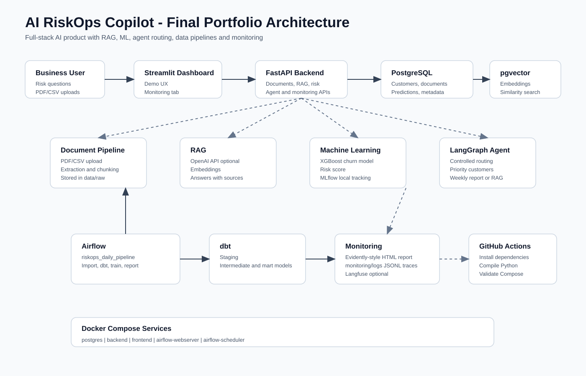

# Architecture du projet

## Vue générale

AI RiskOps Copilot est construit comme un produit IA complet.

Schéma visuel:



Il sépare:

- interface utilisateur
- backend API
- base de données
- recherche documentaire
- modèle ML
- agent IA
- monitoring
- pipelines data

## Architecture MVP

```text
Utilisateur
  -> Streamlit
  -> FastAPI
  -> PostgreSQL
  -> pgvector
```

## Architecture cible

```text
Utilisateur
  -> Streamlit or Next.js
  -> FastAPI
  -> PostgreSQL + pgvector
  -> LlamaIndex RAG
  -> OpenAI API
  -> XGBoost churn model
  -> LangGraph agent
  -> MLflow
  -> Langfuse
  -> Evidently AI
  -> AWS
```

## Rôle des composants

### Streamlit

Interface simple pour tester le produit.

### FastAPI

API centrale qui connecte les modules.

### PostgreSQL

Stocke les données structurées.

### pgvector

Stocke les embeddings pour la recherche sémantique.

### LlamaIndex

Construit le RAG sur les documents.

### XGBoost

Prédit le risque de churn client.

### LangGraph

Crée un agent IA contrôlé.

### MLflow

Trace les expériences ML.

### Langfuse

Observe les appels LLM.

### Evidently AI

Surveille la qualité du modèle ML.
